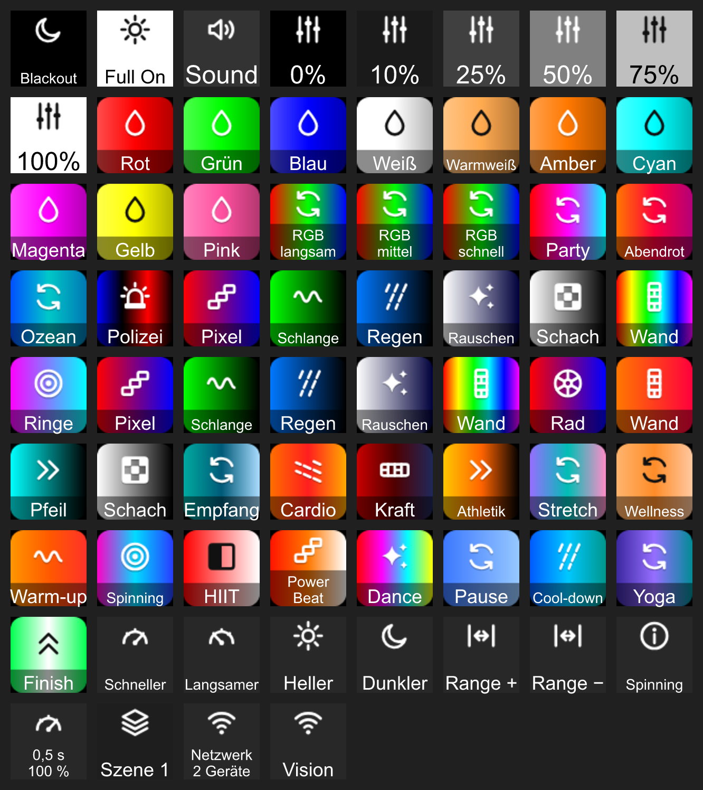

# companion-module-visioncontrol

Ein [Bitfocus Companion](https://bitfocus.io/companion) Modul für die **Vision Control App** von KKT Künzler Technologies. Es steuert die App über ihre lokale REST-API: Szenen und Sequenzen, Farbe und Dimmer, einen Farbwechsel-Effekt sowie den Sound-Trigger.

## Funktionen

- Szenen / Sequenzen an, aus, umschalten
- Farbe und Dimmer für Gruppen oder einzelne Fixtures setzen (mit Überblendung)
- Blackout
- Effekt: laufender RGB-Farbwechsel
- Sound-Control-Trigger
- Feedbacks: aktive Szene, Verbindungsstatus
- Variablen: Netzwerkname, Netzwerk-ID, Anzahl Szenen, Verbindungsstatus

Details zur Einrichtung stehen in [`companion/HELP.md`](companion/HELP.md).

## Entwicklung

Das Modul nutzt `@companion-module/base` 1.12 und ist mit Companion 3.0 bis 4.3 kompatibel.

Abhängigkeiten installieren (Node 18, 20, 22 oder neuer):

```bash
npm install
```

Zum lokalen Testen den Ordner als Developer-Modul in Companion einbinden:
Launcher → Feld **Developer modules path** auf das übergeordnete Verzeichnis
setzen (den Ordner, der `companion-module-visioncontrol` enthält), dann
Companion starten. Companion bringt seine eigene Node-Laufzeit mit; es genügt,
dass `node_modules` im Modulordner vorhanden ist.

### Icon Pack

Alle Grafiken der Presets kommen aus einem eigenen Icon Pack mit einer
gemeinsamen visuellen Sprache: Steuer-Symbole (Blackout, Full On, Dimmer,
Szene, Sequenz, Tempo, Range, Status …), Effekt-Kacheln und Farb-Kacheln.
Jede Preset-Taste trägt ein Symbol aus dem Pack.



Regeln, die für jede Glyphe gelten:

- Raster 24 × 24, Motiv im Feld 2..22
- Linie 2 Einheiten, runde Enden und Ecken
- Flächen nur einfarbig in derselben Tinte, keine Verläufe in der Glyphe
- eine Tinte: weiß auf dunklen, fast schwarz auf hellen Flächen
- Glyphe immer 32 × 32 px, auf der Taste wie auf der Kachel (gleiche Strichstärke)

Kacheln (72 × 72): Verlauf der Effektfarben, Glyphe des Effektmusters mittig,
Schriftstreifen unten (45 % schwarz), Radius 12. Aktiv-Zustand: orangener
Rahmen 3,5 px (`#FF7A00`). Farbfolgen ohne Muster zeigen das Kreislauf-Symbol,
einfarbige Farb-Kacheln den Tropfen.

Die Glyphen stehen in `scripts/iconpack/glyphs.cjs`, das Layout in
`scripts/build-icons.cjs`. Neu erzeugen (Windows, macOS, Linux, ohne
installierte App):

```bash
npm run icons
```

Das schreibt `icons/*.png` und bündelt sie in `src/icons.generated.json`.
Mit `node scripts/build-icons.cjs --svg <ordner>` entstehen die SVG-Quellen,
etwa für Grafik-Programme oder die Dokumentation.

Ein verteilbares Paket bauen (optional, benötigt die Build-Tools):

```bash
npm run package
```

## Lizenz

MIT, siehe [LICENSE](LICENSE).
